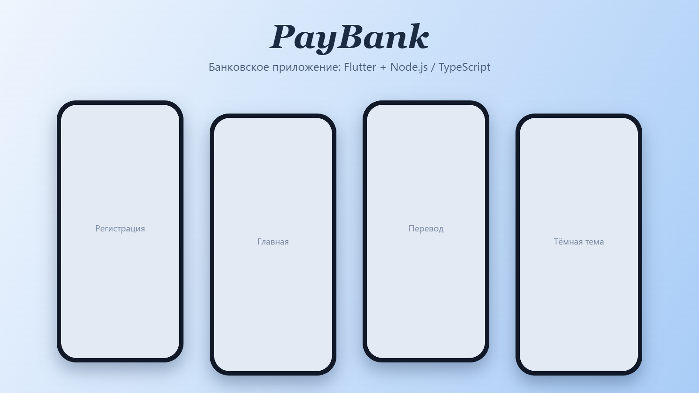

[🇬🇧 English version](README.en.md)

# PayBank

Мобильный банк написан в связке Flutter + сервер на Node.js(TypeScript).
Регистрируешься по имени и номеру телефона, получаешь карту с приветственными 5 000 ₽ и можешь переводить деньги другим картам.



(https://github.com/USER/REPO/actions)

**Сервер:** https://paybank-ki76.onrender.com

> Сервер лежит на бесплатном тарифе Render и засыпает без нагрузки. Первый запрос может идти 30–60 секунд, потом всё работает быстро. В приложении на этот случай есть плашка «Идет подготовка данных».

## Что умеет

- Регистрация по имени и телефону (маска ввода, проверка номера)
- Сервер выдаёт новую карту и счёт, на нём сразу 5 000 ₽
- Главный экран: баланс, карточка, список операций
- Переводы по номеру карты: минимум 100 ₽, проверка баланса и существования карты
- Курсы USD / EUR / CNY к рублю, обновляются свайпом вниз
- Светлая и тёмная тема, переключатель в шапке

## Что здесь показано

Проект учебный, и в нём я отрабатывала связку клиента и сервера:

- **BLoC**: события, состояния (загрузка, успех, ошибка) и отдельный слой для работы с API
- **Dio**: запросы к своему серверу, таймауты, обработка ошибок
- **Свой REST-сервер** на Express + TypeScript: регистрация, счета, переводы, курсы валют
- **CI** в GitHub Actions и автодеплой на Render

## Из чего сделано

**Приложение (`bank_client`)**
- Flutter, Material 3
- `flutter_bloc` + `equatable` для состояния
- `dio` для запросов
- `mask_text_input_formatter`, `google_fonts`

**Сервер (`server`)**
- Node.js, Express 5, TypeScript (strict)
- `axios` для курсов валют, `cors`, `dotenv`
- GitHub Actions: на каждый push собирается сервер (`tsc`)
- Деплой на Render из этого репозитория

## API

| Метод | Адрес | Что делает |
|-------|-------|------------|
| POST | `/api/register` | `{ name, phone }`, создаёт аккаунт и карту. Если телефон уже есть, вернёт существующий |
| GET | `/api/account/:cardNumber` | данные счёта по карте |
| POST | `/api/transfer` | `{ senderCardNumber, recipientCardNumber, amount }` |
| GET | `/api/rates` | курсы валют (open.er-api.com) |

## Как запустить

Сервер:

```bash
cd server
npm install
npm run dev
```

Приложение:

```bash
cd bank_client
flutter pub get
flutter run
```

Адрес сервера лежит в `lib/data/services/api_constants.dart`. Для локальной проверки поменяй его на `http://10.0.2.2:3000` (эмулятор Android).

Чтобы попробовать перевод без регистрации второго аккаунта, можно отправить деньги на тестовую карту `4400-9999-8888-7777`.

## Что здесь упрощено

Это учебный проект, и я знаю, где он не дотягивает до настоящего банка:

- Данные хранятся в памяти сервера и сбрасываются при перезапуске. Следующий шаг: PostgreSQL.
- Нет авторизации: телефон работает как идентификатор. Нужны пароль или SMS-код и JWT.
- Баланс на экране обновляется на клиенте сразу после перевода. Правильнее ждать ответ сервера.
- Тестов пока нет. Хочу покрыть сервер тестами и добавить `flutter analyze` в CI.

## Автор

ТВОЁ ИМЯ, [GitHub](https://github.com/USER) · [Telegram](https://t.me/USERNAME)
